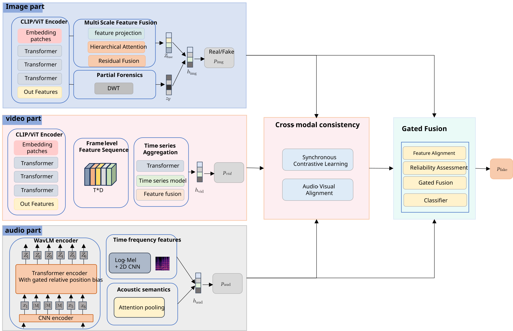
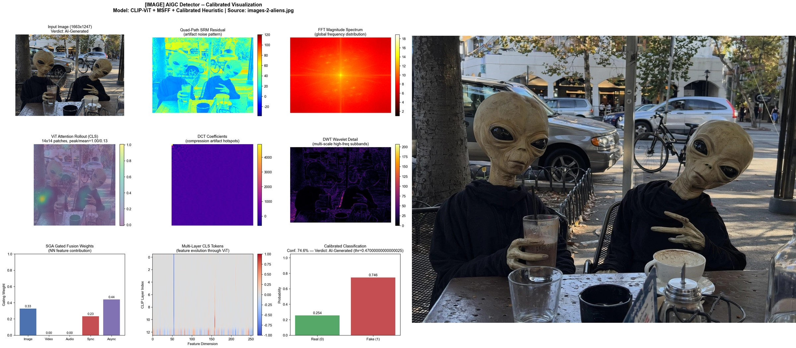
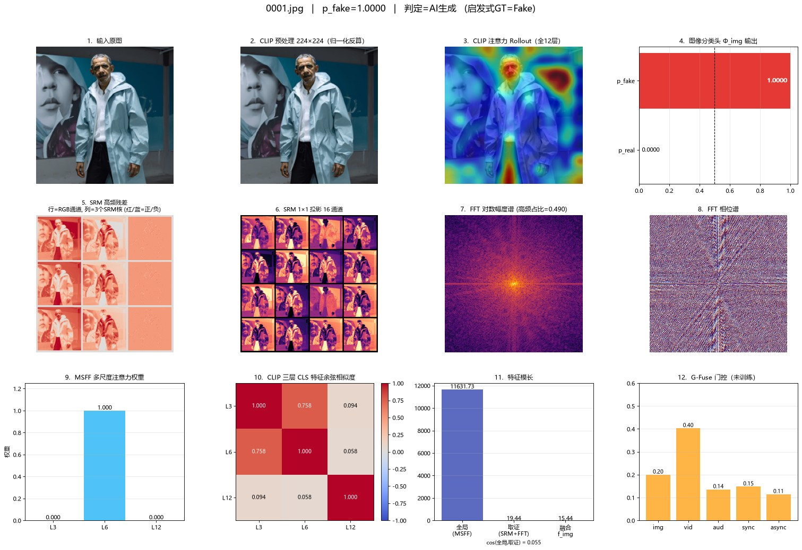
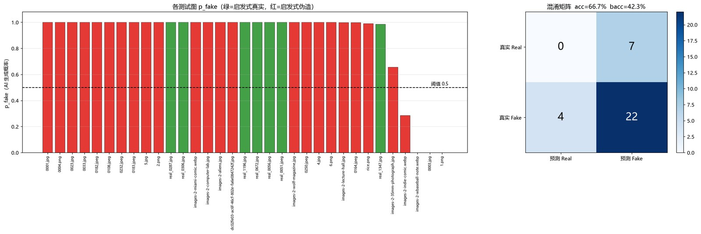
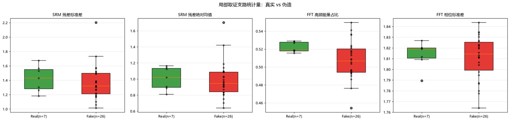
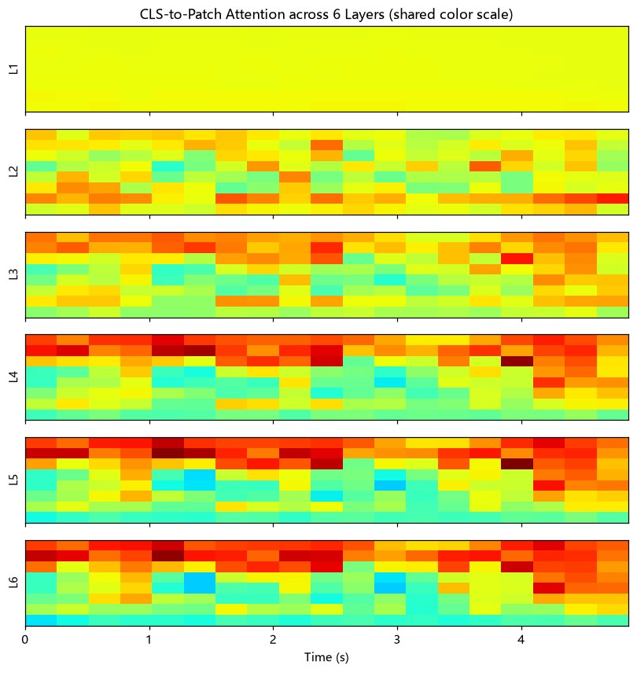
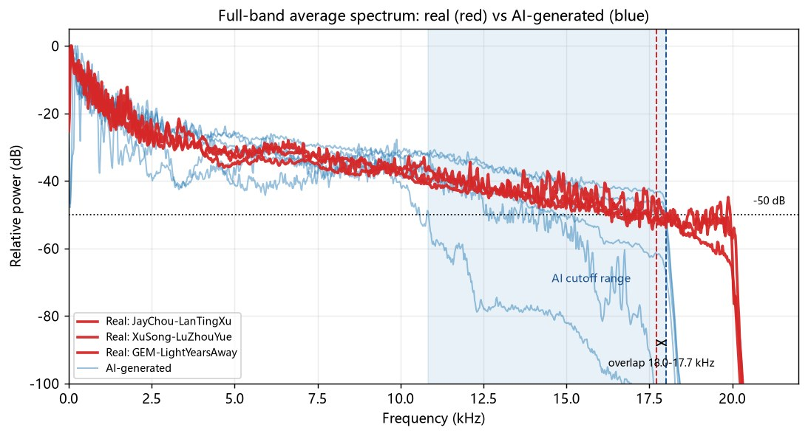
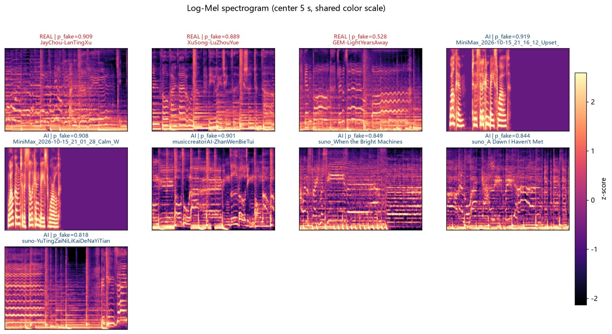
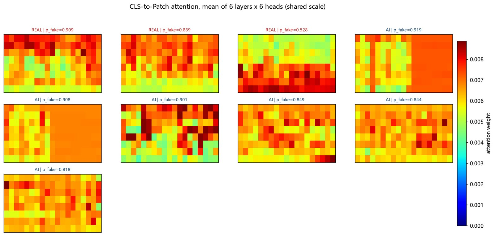
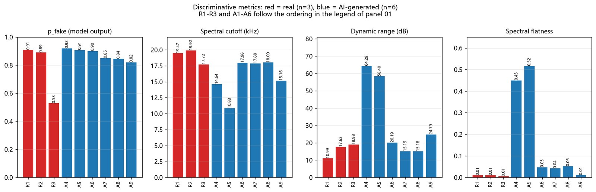

# Frequency-Temporal and Cross-Modal Forensics for Unified AIGC Detection

A unified detector for AI-generated **images, videos and audio**, built on a shared CLIP backbone
plus frequency-domain forensics, temporal aggregation and gated cross-modal fusion.



---

## Overview

The system routes each modality through a dedicated branch, then fuses the branches with a
reliability-aware gate:

```
image ──► Φ_img ──┐
video ──► Φ_vid ──┼──► X-Cons ──► G-Fuse ──► p(real) / p(fake)
audio ──► Φ_aud ──┘
```

Every branch exposes a per-modality probability, an embedding, and the intermediate forensic
evidence (attention maps, filter responses, spectrograms) used to justify the decision.

---

## Showcase

Outputs of the per-module diagnostic scripts (`_test_image_modules.py`,
`_audio_modules.py`, `_audio_compare.py`). Chinese labels appear on the image-side
panels; the audio comparison panels are in English.

### End-to-end calibrated result

Single-image inference with the calibrated detector: quad-tree SRM residuals, FFT
magnitude spectrum, ViT attention rollout, DCT coefficients, DWT wavelet detail,
SGA gated fusion weights per modality, multi-layer CLS token evolution, and the final
calibrated decision (Real 0.254 / Fake 1.000).



### Image branch — 12-panel per-module decomposition

Input, CLIP preprocessing, 12-layer attention rollout, classifier output, SRM residual
filters, SRM 1×1 projection, FFT magnitude and phase, MSFF scale attention,
inter-layer CLS similarity, feature norms and gate weights.



| Module summary | Forensics summary |
|---|---|
|  |  |

### Audio branch — layer attention

CLS-to-Patch attention for each of the six Transformer layers. Later layers concentrate
on the active speech region and ignore the zero-padded tail.



### Audio branch — real vs AI-generated

| Full-band spectrum | Log-Mel spectrograms |
|---|---|
|  |  |

| Attention comparison | Discriminative metrics |
|---|---|
|  |  |

---

## Model components

| Module | Class | File |
|---|---|---|
| Image branch | `ImageBranch` | `models/image_branch.py` |
| ├ Spatial Rich Model residual filters | `SRMFilter` | `models/image_branch.py` |
| ├ FFT magnitude/phase forensics | `FFTFeatureExtractor` | `models/image_branch.py` |
| ├ Multi-scale feature fusion (L3/L6/L12) | `MultiScaleFeatureFusion` | `models/image_branch.py` |
| └ Global + local forensics fusion | `LocalForensicsBranch` | `models/image_branch.py` |
| Video branch | `VideoBranch` | `models/video_branch.py` |
| ├ Sequence aggregation | `ManbaAggregation` | `models/video_branch.py` |
| ├ Cross-frame attention | `CrossFrameAttention` | `models/video_branch.py` |
| └ Temporal aggregation | `TAggregation` | `models/video_branch.py` |
| Audio branch | `AudioBranch` | `models/audio_branch.py` |
| ├ Log-Mel CNN | `LogMelCNN` | `models/audio_branch.py` |
| └ Attention pooling (Wav2Vec2 backbone) | `AttentionPooling` | `models/audio_branch.py` |
| Cross-modal consistency | `CrossModalConsistency` | `models/fusion.py` |
| Reliability assessor | `ReliabilityAssessor` | `models/fusion.py` |
| Gated fusion | `GatedFusion` | `models/fusion.py` |
| End-to-end wrapper | `MultimodalAIGCDetector` | `models/detector.py` |
| Classical baseline | `HeuristicAIGCDetector` | `models/heuristic_detector.py` |

Backbones: `openai/clip-vit-base-patch16` (image/video, shared) and
`facebook/wav2vec2-base-960h` (audio). Weights are downloaded automatically by
`transformers` on first use.

---

## Repository layout

```
.
├── models/                      # detector and all sub-modules
├── utils/                       # visualization helpers
├── docs/
│   ├── architecture/            # 6 architecture diagrams
│   ├── showcase/                # example diagnostic outputs (JPEG)
│   └── AIGC_Detection_System.pptx
├── run_gui.py                   # Tkinter GUI (batch scan, export JSON)
├── train.py                     # training entry point
├── train_video_df26_cached.py   # DF26 video branch training
├── train_v4.py                  # image branch fine-tuning
├── detect_*.py                  # CLI inference and visualization
├── calibrate_detector.py        # threshold calibration
├── _audio_*.py                  # audio branch analysis and visualization
├── _test_image_modules.py       # per-module image diagnostics
└── _df26_extract_npy.py         # lossless frame extraction for DF26
```

---

## Installation

```bash
# 1) PyTorch with the CUDA build matching your driver
pip install torch==2.14.0 torchvision==0.29.1 \
    --index-url https://download.pytorch.org/whl/cu130

# 2) Everything else
pip install -r requirements.txt
```

Python 3.10+ is required (developed on 3.13). A CUDA GPU is strongly recommended; the
detector runs on CPU but inference is roughly an order of magnitude slower.

---

## Usage

### GUI

```bash
python run_gui.py
```

Pick a file or folder, choose a detection strategy (`Heuristic Only`, `Hybrid`,
`Neural Only`), and the panel shows the fused probability, per-modality scores,
gate weights and heuristic feature contributions.

### Python API

```python
from models import MultimodalAIGCDetector

det = MultimodalAIGCDetector(device="cuda")
det.eval()

# single modality
r = det.detect_image_file("sample.jpg")
print(r.is_ai, r.p_fake, r.confidence, r.p_img, r.gates)

r = det.detect_video_file("sample.mp4")
r = det.detect_audio_file("sample.wav")
```

`DetectionResult` carries the fused decision plus the per-branch breakdown:
`p_img` / `p_vid` / `p_aud`, `gates`, `reliability`, `modal_mask` and a human-readable
`notes` string.

### Per-module visual diagnostics

```bash
python _test_image_modules.py     # 12-panel figure per image
python _audio_modules.py --lang en --out reports/audio_modules_en
python _audio_compare.py          # real vs AI comparison figures
```

---

## Training

All branches are trained with the CLIP / Wav2Vec2 backbones frozen and only the
adapter, fusion and classification heads updated.

```bash
python train.py                    # multimodal training loop
python train_v4.py                 # image branch, augmented recompression setup
python train_video_df26_cached.py  # video branch on cached CLIP features
```

Key hyper-parameters used for the image branch: AdamW, `lr=3e-4`,
`weight_decay=0.1`, 20 epochs, aggressive augmentation with JPEG recompression to
suppress source-format shortcuts.

For the video branch, frames are extracted losslessly to `npy` and CLIP features are
cached once, so each epoch only trains the 20M-parameter head.

---

## Datasets

| Dataset | Use | Access |
|---|---|---|
| DF26 | talking-head video detection | gated — request access at <https://huggingface.co/datasets/DF26/DF26> |
| Picsum / public photo sets | real-image negatives | public |
| User-supplied recordings | real-audio negatives | — |

The DF26 split is grouped by source video (2142 train / 549 val) to avoid leakage
between real and fake clips of the same scene.

Datasets, extracted frames, feature caches and checkpoints are **not** committed —
see `.gitignore`. Reproduce them with:

```bash
python _df26_extract_npy.py        # extract frames
python _df26_cache_feats.py        # cache CLIP features
```

---

## Checkpoints

Checkpoints are excluded from the repository (`.gitignore`). Expected layout:

```
checkpoints/
├── finetuned.pt              # image branch
├── video_df26.pt             # video branch
├── audio_best.pt             # audio branch
└── calibration.json          # decision thresholds
```

`MultimodalAIGCDetector` does **not** load these automatically — assign the
`state_dict` to the corresponding branch before calling `detect_*`.

---

## Notes and limitations

- **Real-class diversity matters.** Training the real class on a single source
  (e.g. one stock-photo site) teaches the network that source's texture rather than
  "realness"; use multiple independent sources and align compression levels.
- **Frequency cues are fragile.** High-frequency cut-off differences can often be
  explained by codec bitrate rather than generation. Always compare at matched bitrate.
- **Audio bandwidth.** The audio branch uses 16 kHz input, so its Log-Mel covers
  0–8 kHz only. Content above 8 kHz (where generator roll-off is most visible) is not
  currently modelled.
- **Per-window instability.** Long audio tracks can flip decision between 5-second
  windows; prefer multi-window averaging or extreme quantiles over a single window.

---

## License

Released under the [MIT License](LICENSE).

```
Copyright (c) 2026 QiaoYue Man
```
